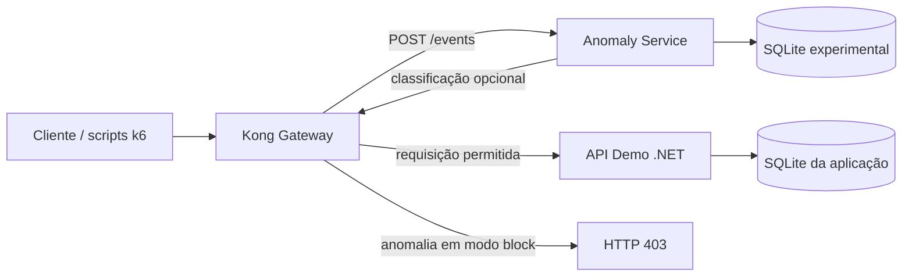

# API Anomaly Detection Middleware

Protótipo experimental de um **middleware inteligente e desacoplado para detecção de anomalias em requisições de APIs**, desenvolvido como parte de um Trabalho de Conclusão de Curso em Análise e Desenvolvimento de Sistemas.

A solução intercepta tráfego HTTP por meio do **Kong Gateway**, envia os atributos das requisições para um serviço independente de análise comportamental e utiliza **Isolation Forest** para identificar comportamentos anômalos. O mecanismo de detecção permanece externo à aplicação protegida, sem exigir alterações em seu código-fonte.

> Neste projeto, o termo *middleware inteligente* representa a camada lógica formada pela integração entre o gateway e o serviço de análise comportamental, e não um único componente isolado.

## Arquitetura



Principais componentes:

| Componente | Tecnologia | Responsabilidade |
|---|---|---|
| API Demo | ASP.NET Core / .NET 10 | Backend experimental |
| Kong Gateway | Kong 3.9.3 | Proxy, roteamento e interceptação |
| Plugin `anomaly-collector` | Lua | Coleta de atributos, comunicação com o serviço de análise e aplicação da decisão |
| Anomaly Service | Python 3.13 / FastAPI 0.141.1 | Processamento comportamental e inferência |
| Modelo | Isolation Forest / scikit-learn 1.9.0 | Detecção não supervisionada de anomalias |
| Persistência | SQLite | Dados da aplicação e dados experimentais em bases separadas |
| Geração de tráfego | k6 | Cenários experimentais e medições de latência |
| Infraestrutura | Docker / Docker Compose | Isolamento e integração dos serviços |

## Fluxo de processamento

1. O cliente envia uma requisição ao Kong Gateway.
2. O plugin Lua extrai atributos da requisição e chama `POST /events` no Anomaly Service.
3. O Anomaly Service normaliza a rota, atualiza o estado comportamental e calcula as características derivadas.
4. Eventos elegíveis são submetidos ao pré-processador e ao Isolation Forest quando o modelo está carregado.
5. O evento e, quando disponíveis, suas características comportamentais são persistidos.
6. A classificação é devolvida ao Kong.
7. O gateway aplica a política configurada:
   - `log_only`: registra a decisão e permite a requisição;
   - `block`: bloqueia anomalias com HTTP `403` e permite requisições normais.
8. Na ausência de classificação, a requisição é permitida. Falhas de comunicação ou respostas inválidas seguem uma estratégia *fail-open*.

## Características utilizadas pelo modelo

O conjunto atual utiliza sete características:

- `http_method`
- `route`
- `payload_size_bytes`
- `query_param_count`
- `inter_arrival_ms`
- `requests_last_10s`
- `distinct_routes_last_30s`

As características `http_method` e `route` passam por *one-hot encoding*. As demais são convertidas para `float64` sem padronização adicional.

Campos de controle experimental, como `run_id`, `client_id`, `scenario`, `expected_class` e `request_id`, **não são utilizados como atributos preditivos**.

O estado comportamental é isolado pela combinação `(run_id, client_id)`. A primeira requisição de cada estado é utilizada como aquecimento e não é submetida ao modelo porque ainda não existe valor anterior para o cálculo de `inter_arrival_ms`.

## Estrutura do projeto

```text
api-anomaly-detection/
├── compose.yaml
├── global.json
├── src/
│   ├── anomaly-service/
│   │   ├── app/
│   │   │   ├── persistence/
│   │   │   └── services/
│   │   ├── Dockerfile
│   │   └── requirements.txt
│   ├── api-demo/
│   │   ├── Controllers/
│   │   ├── Data/
│   │   ├── Migrations/
│   │   ├── Models/
│   │   ├── Dockerfile
│   │   └── ApiDemo.csproj
│   └── kong/
│       ├── plugins/anomaly-collector/
│       ├── Dockerfile
│       └── kong.yml
├── tests/
│   └── k6/
│       ├── normal-navigation.js
│       ├── normal-order.js
│       ├── normal-order-lookup.js
│       ├── anomaly-burst.js
│       ├── anomaly-payload.js
│       ├── anomaly-query-params.js
│       ├── anomaly-route-diversification.js
│       ├── anomaly-method-route.js
│       ├── latency-comparison.js
│       └── smoke.js
└── results/
    └── latency/
        ├── official/
        ├── pilot-sequential/
        └── P0/
```

Diretórios locais de IDE, ambientes virtuais e artefatos de build não fazem parte da estrutura versionada do projeto.

## Pré-requisitos

Para executar a arquitetura completa, é necessário ter **Docker Engine + Docker Compose**.

Para executar os scripts experimentais diretamente no host, também é necessário instalar o **k6**.

## Executando o ambiente

A partir da raiz do repositório:

```powershell
docker compose up --build -d
```

Verifique os contêineres:

```powershell
docker compose ps
```

Serviços expostos localmente:

| Serviço | Endereço |
|---|---|
| Kong Proxy | `http://localhost:8000` |
| Kong Admin API | `http://localhost:8001` |
| API Demo direta | `http://localhost:8080` |
| Anomaly Service | `http://localhost:8090` |

### Verificação do Anomaly Service

No PowerShell:

```powershell
Invoke-RestMethod http://localhost:8090/health
```

Exemplo de resposta:

```json
{
  "status": "ok",
  "model_loaded": false
}
```

`model_loaded` será `true` quando o artefato treinado estiver disponível e tiver sido carregado na inicialização do serviço.

### Requisição pela camada de gateway

```powershell
Invoke-RestMethod http://localhost:8000/products
```

### Smoke test

```powershell
k6 run .\tests\k6\smoke.js
```

## Treinamento e avaliação do modelo

O treinamento é realizado offline a partir dos eventos persistidos na base experimental. Os conjuntos de treinamento, validação e teste são selecionados por identificadores de execução explícitos definidos em `src/anomaly-service/app/persistence/dataset_repository.py`.

Em um ambiente novo, os cenários correspondentes precisam ser executados antes do treinamento para popular a base experimental.

Com os dados necessários disponíveis no volume do Anomaly Service, o modelo pode ser treinado com:

```powershell
docker exec anomaly-service python -m app.services.model_training
```

O artefato contém o pré-processador, o Isolation Forest, o limiar calibrado e a taxa-alvo de falsos positivos. Como o modelo é carregado na inicialização do serviço, após um primeiro treinamento execute:

```powershell
docker compose restart anomaly-service
```

Confirme o carregamento:

```powershell
Invoke-RestMethod http://localhost:8090/health
```

A avaliação sobre os conjuntos experimentais definidos pode ser executada com:

```powershell
docker exec anomaly-service python -m app.services.model_evaluation
```

O conjunto de teste permanece separado das etapas de treinamento e calibração do limiar.

## Cenários experimentais

Os scripts em `tests/k6/` implementam três fluxos de comportamento esperado — navegação por produtos, criação de pedidos e consulta de pedidos — e cinco cenários controlados de comportamento anômalo:

| Cenário | Comportamento |
|---|---|
| Burst | Aumento abrupto da frequência de requisições |
| Payload | Corpo de requisição com tamanho atípico |
| Query parameters | Quantidade elevada de parâmetros de consulta |
| Route diversification | Acesso a múltiplas rotas não observadas no histórico de referência |
| Method-route | Combinação incomum entre método HTTP e rota |

Os metadados `scenario` e `expected_class` são utilizados apenas como *ground truth* experimental e não entram no modelo.

## Avaliação de latência

O script `tests/k6/latency-comparison.js` suporta três perfis:

| Perfil | Caminho avaliado |
|---|---|
| P0 | k6 → API Demo |
| P1 | k6 → Kong → API Demo, sem análise comportamental |
| P2 | k6 → Kong → plugin → Anomaly Service → modelo → Kong → API Demo |

O protocolo utiliza um único usuário virtual, requisições sequenciais, 20 requisições de aquecimento e 100 medições por execução. A operação utilizada pelo script é `GET /products/1` e o intervalo padrão entre requisições é de `1.2 s`.

A configuração foi projetada para medir **overhead de latência em condições controladas**, e não throughput máximo ou escalabilidade.

## Resultados experimentais

Os artefatos atualmente versionados em `results/` correspondem à avaliação de latência:

```text
results/latency/
├── official/          # execuções oficiais e arquivos consolidados
├── pilot-sequential/  # execuções piloto preservadas para rastreabilidade
└── P0/                # pré-validação do ambiente
```

A pasta `official/` contém as medições dos cinco blocos experimentais, os arquivos consolidados de perfil e overhead e uma execução inválida preservada para rastreabilidade.

A discussão quantitativa consolidada dos resultados faz parte da etapa de Resultados e Discussão do trabalho acadêmico.

## Persistência e volumes

O Docker Compose utiliza volumes separados para a API Demo e para o Anomaly Service:

- `api-demo-data`: dados da aplicação de demonstração;
- `anomaly-data`: base experimental e artefato do modelo.

Para encerrar os serviços sem remover os dados:

```powershell
docker compose down
```

> **Atenção:** `docker compose down -v` remove os volumes e, consequentemente, a base experimental e o artefato do modelo. Não utilize `-v` se quiser preservar os dados coletados.

## Limitações

Este repositório contém um **protótipo experimental**, não um produto de segurança pronto para produção. A avaliação foi realizada em ambiente local e controlado. O estado comportamental é mantido em memória por uma única instância do Anomaly Service; não foi avaliado o compartilhamento de estado entre múltiplas réplicas. O estudo utiliza um conjunto específico de características, um único algoritmo não supervisionado e uma API de demonstração em .NET. Os experimentos de latência não representam testes de alta concorrência ou capacidade máxima de processamento.

A independência tecnológica proposta é arquitetural: a detecção atua na camada HTTP e não depende do código-fonte do backend. O protótipo não foi comparado experimentalmente com aplicações implementadas em diferentes linguagens ou frameworks.

## Contexto acadêmico

Projeto desenvolvido para o Trabalho de Conclusão de Curso em **Análise e Desenvolvimento de Sistemas — Universidade do Vale do Rio dos Sinos (UNISINOS)**.

**Título do trabalho:** *Projeto e Avaliação de um Middleware Inteligente para Detecção de Anomalias em APIs: Uma Abordagem Desacoplada e Agnóstica para Arquiteturas de Microserviços.*

**Autora:** Ruana Boeira Soares
